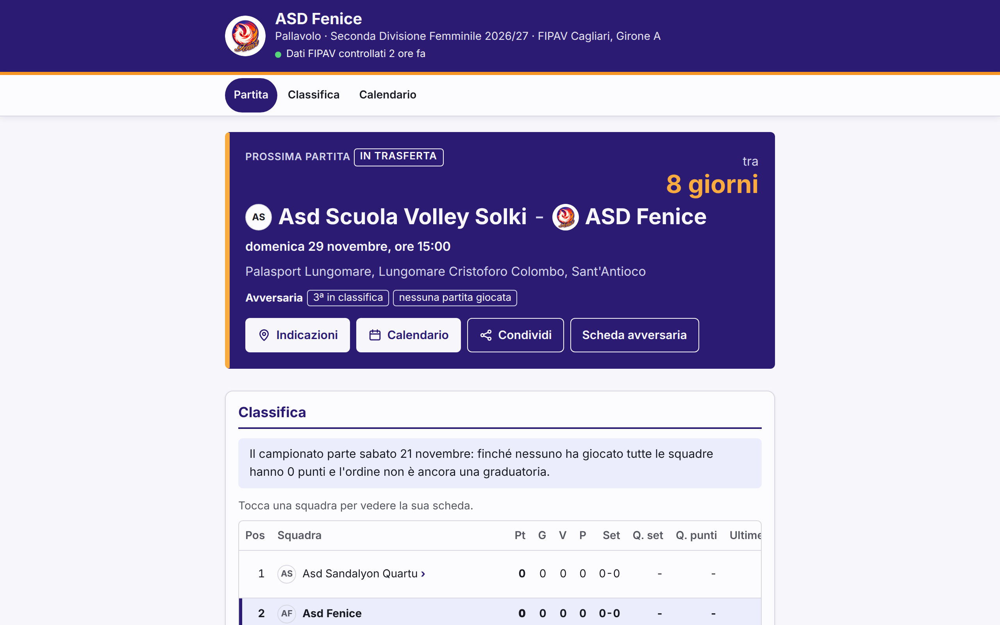
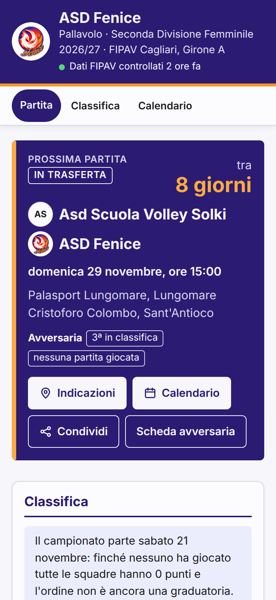
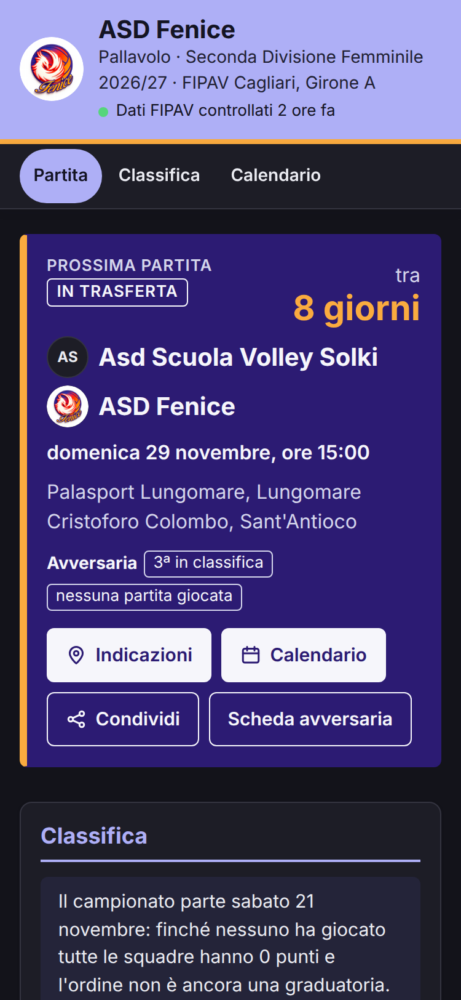
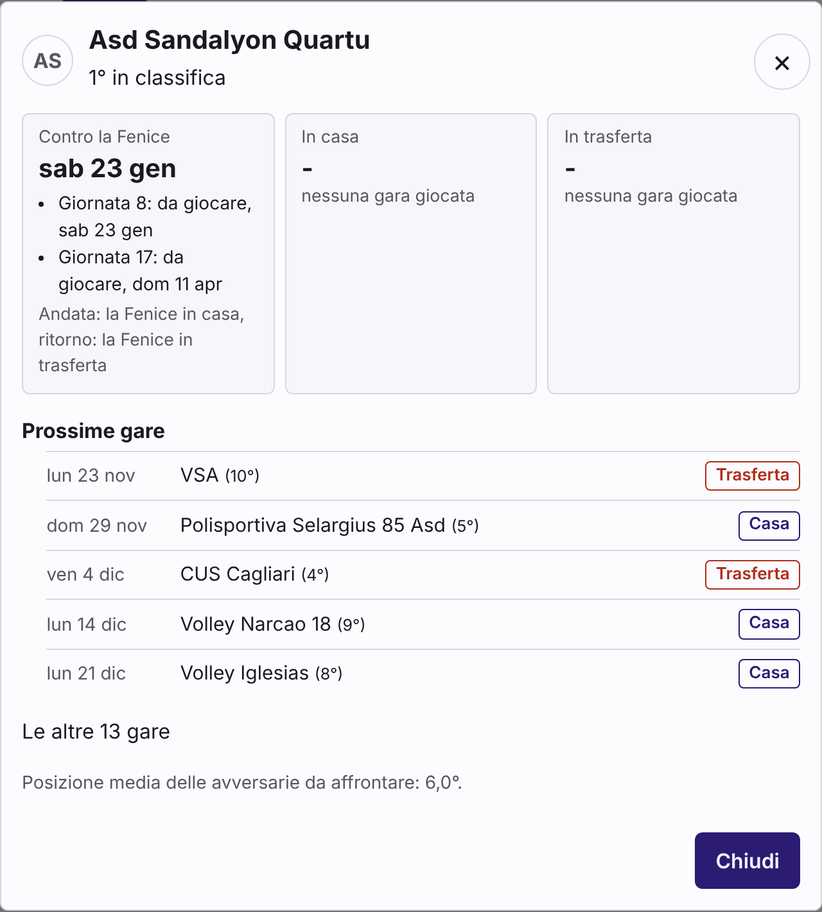
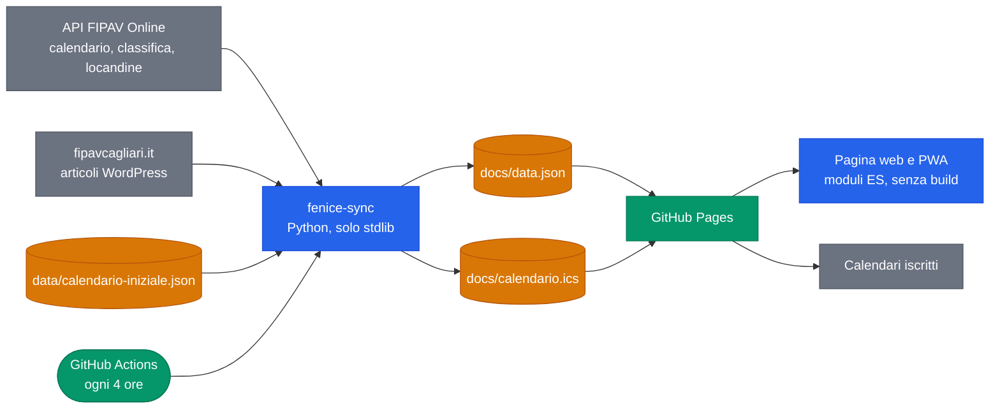

[English](./README.md) | **Italiano**

# Campionato Fenice 2026/27

Pagina non ufficiale con calendario, risultati e classifica della ASD Fenice nella Seconda Divisione Femminile FIPAV Cagliari, Girone A, stagione 2026/27, allineata a FIPAV Online ogni 4 ore.

Sito: https://andreabonn.github.io/campionato-fenice-fipav-26-27/

   

La pagina risponde alle domande che un'atleta, un genitore o un tifoso si fanno durante la stagione: quando e dove si gioca la prossima partita, com'è finita l'ultima, a che punto è la squadra in classifica. È tutta in italiano, funziona sul telefono e si può installare come un'app.

Una GitHub Action programmata legge le API JSON di FIPAV Online per il girone `64444`, le unisce al calendario iniziale della stagione e alle notizie del Comitato di Cagliari, e scrive un `data.json` validato e un calendario iCalendar. La pagina è statica: moduli ES che leggono quel file, senza build e senza dipendenze a runtime.

## In pratica



<p>
  
  
</p>

Schermate del 21 novembre 2026, prima della prima giornata: tutte le squadre sono ancora a 0 punti.

## Cosa mostra la pagina

- **Prossima partita**: avversaria, data, ora, palestra, conto alla rovescia, indicazioni stradali, la locandina e il collegamento alla diretta quando FIPAV li pubblica.
- **Ultimo risultato** e una striscia con le ultime cinque partite.
- **Calendario e risultati**, giornata per giornata: punteggi dei set, l'arbitro quando è designato e un'etichetta sulle partite con data, ora o palestra diverse dal calendario iniziale.
- **Classifica** come la pubblica FIPAV, penalità comprese, con la Fenice in evidenza. Quando la classifica si restringe, per ogni squadra indica le posizioni finali ancora possibili e cosa è già deciso.
- **Scheda di ogni avversaria**, che si apre dalla classifica o dalla prossima partita: sfida diretta con la Fenice, partite rimaste, rendimento in casa e in trasferta.
- **Andamento della Fenice**: set vinti e persi, tie-break, set combattuti, casa e trasferta, calendario che resta.
- **Notizie del Comitato** sulla Seconda Divisione, nascoste finché non ce ne sono.
- **Calendario sul telefono**: un feed `.ics` a cui iscriversi, che si aggiorna da solo, oppure la singola partita su Google Calendar.
- **App installabile**, con un avviso quando esce una versione nuova.

La formula del campionato non è ancora pubblicata: la classifica non mostra zone di promozione o retrocessione, e a parità di punti vale un criterio provvisorio: vittorie, poi quoziente set, poi quoziente punti.



## Fonti dei dati

I dati di gara arrivano da [FIPAV Online](https://www.fipavonline.it), le notizie dal [Comitato FIPAV di Cagliari](https://fipavcagliari.it). Gli stemmi delle avversarie si caricano da FIPAV Online; se uno non si carica, la pagina mostra le iniziali della squadra. I dati appartengono alla FIPAV: questa pagina li riporta come vengono pubblicati e non è un sito ufficiale della Federazione né della società.

Se FIPAV Online non risponde, l'aggiornamento fallisce senza scrivere nulla: la pagina tiene gli ultimi dati validi e l'ora dell'ultimo controllo riuscito non cambia. Un risultato inserito in federazione può comparire fino a 4 ore dopo.

## Stack tecnologico

- **Sincronizzazione**: Python 3.12+, solo libreria standard (`urllib`, `json`, `zoneinfo`). Strumenti di sviluppo tramite [uv](https://docs.astral.sh/uv/): pytest, pytest-cov, ruff, mypy in modalità strict.
- **Pagina**: HTML, CSS e moduli ES, nessun framework, nessun bundler, nessuna dipendenza npm. Service worker e web manifest per l'uso offline e l'installazione.
- **Hosting e automazione**: GitHub Pages, GitHub Actions.

## Architettura



`fenice-sync` prova prima `data.fipavonline.it` e poi `app.fipavonline.it` come riserva, una richiesta al secondo. La Fenice si riconosce dal codice di affiliazione FIPAV, non dal nome né dall'id della squadra. Tutti i file vengono costruiti in memoria e validati sullo schema prima di scrivere, poi messi al loro posto insieme.

## Prerequisiti

- [uv](https://docs.astral.sh/uv/) (installa Python 3.12 se manca)
- Node.js, per i test JavaScript. Non c'è una versione minima fissata: i test usano il runner integrato `node --test`.

## Installazione

1. Clona il repository ed entra nella cartella.
2. Prepara l'ambiente Python e verifica l'import:

   ```bash
   npm run setup
   ```

Non servono un file `.env` né chiavi API: entrambe le fonti sono pubbliche.

## Esecuzione locale

```bash
npm run sync      # scarica FIPAV e Comitato, aggiorna docs/data.json, calendario.ics, status.json
npm run serve     # server statico su docs/ all'indirizzo http://localhost:8000
```

`npm run sync` usa la rete. La sola pagina si può servire con il `docs/data.json` già presente nel repository.

## Struttura del repository

```text
.github/workflows/    sync.yml (sincronizzazione e deploy), tests.yml (test e badge)
assets/               logo della società e schermate del README
data/                 calendario-iniziale.json, il calendario di partenza
docs/                 il sito pubblicato: index.html, moduli JS, stili, data.json, calendario.ics, sw.js
scripts/              generatore delle icone e benchmark della classifica
specs/                requisiti, piano e lista dei task
src/fenice_calendar/  la pipeline di sincronizzazione
tests/                suite pytest, tests/js per la pagina, tests/fixtures con le risposte congelate
```

## Moduli principali

| Modulo | Ruolo |
|---|---|
| `fetch.py` | HTTP con host di riserva, timeout, limite di frequenza; risposte non JSON rifiutate |
| `parse.py`, `merge.py` | da calendario e classifica FIPAV alle partite; differenze dal calendario iniziale |
| `notices.py`, `posters.py`, `enrich.py` | notizie del Comitato e locandine; se la fonte è giù si tengono le precedenti |
| `schema.py` | schema di `data.json` (versione 1), chiavi inattese e dati incoerenti rifiutati |
| `ics.py` | feed iCalendar, Europe/Rome, UID stabile per partita |
| `output.py` | scritture atomiche, file riscritti solo se il contenuto cambia |
| `cli.py` | entry point `fenice-sync`; se fallisce salva le risposte ricevute in `reports/sync-failure/` |

Comandi da riga di comando, da `pyproject.toml`:

| Comando | A cosa serve |
|---|---|
| `uv run fenice-sync` | esegue la sincronizzazione |
| `uv run fenice-stamp-sw` | scrive la versione dell'app in `docs/sw.js` (solo CI) |
| `uv run fenice-badges` | trasforma i report JUnit e di copertura nei JSON per shields.io (solo CI) |

## Testing

```bash
npm run test:py   # pytest con copertura dei rami
npm test          # regole e viste della pagina, node --test
npm run lint      # ruff e mypy --strict su src e tests
```

I test non toccano mai la rete né il `docs/data.json` in uso: girano su risposte FIPAV e WordPress congelate in `tests/fixtures/`. Quando FIPAV cambia la forma di una risposta, l'esecuzione fallita carica ciò che ha ricevuto come artifact `fipav-responses`, e quel file diventa la nuova fixture.

## Deploy e CI/CD

- `.github/workflows/sync.yml` gira ogni 4 ore (al minuto 17), a ogni push su `main` e su richiesta. Esegue le due suite di test e la sincronizzazione, fa il commit di `data.json` e `calendario.ics` se sono cambiati, scrive la versione dell'app nel service worker e pubblica `docs/` su GitHub Pages. Il report di sviluppo in `docs/` viene tolto prima della pubblicazione.
- `.github/workflows/tests.yml` gira a ogni push su `main`: test con copertura, ruff e mypy. Pubblica i badge di test e copertura sul branch `badges`, anche quando l'esecuzione è rossa.

Le action sono fissate allo SHA del commit.

## Sicurezza

Per segnalare una vulnerabilità, consulta [SECURITY.it.md](./SECURITY.it.md).

## Licenza

Rilasciato con licenza MIT. Vedi [LICENSE](./LICENSE). I dati di gara appartengono alla FIPAV.

## Supporta il progetto

Se la pagina ti è utile, lascia una stella al [repository](https://github.com/AndreaBonn/campionato-fenice-fipav-26-27) su GitHub.

Curato da [Andrea Bonacci](https://github.com/AndreaBonn).
