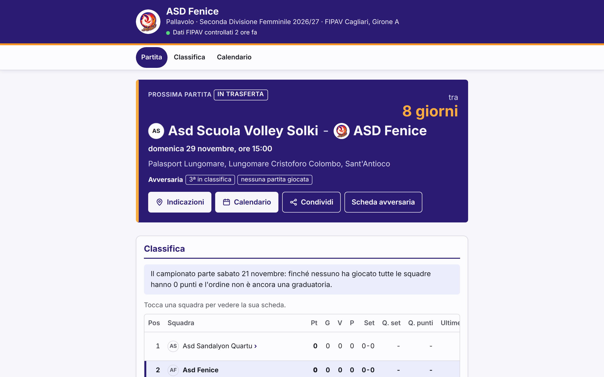
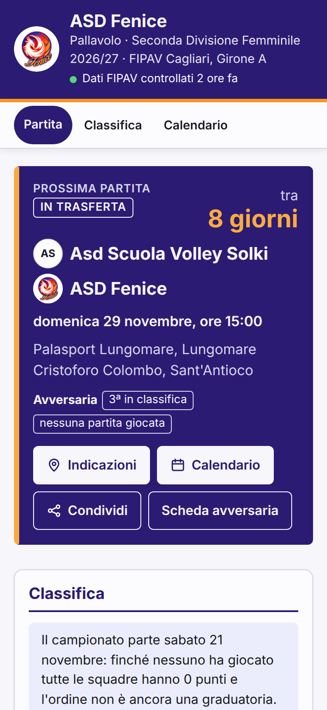
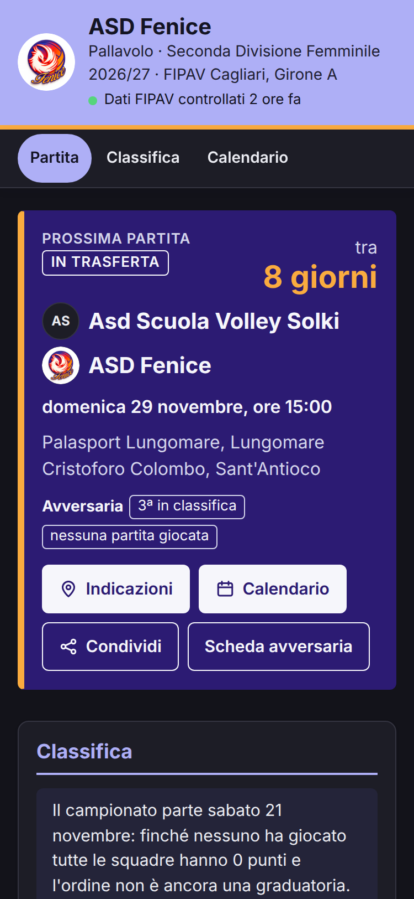
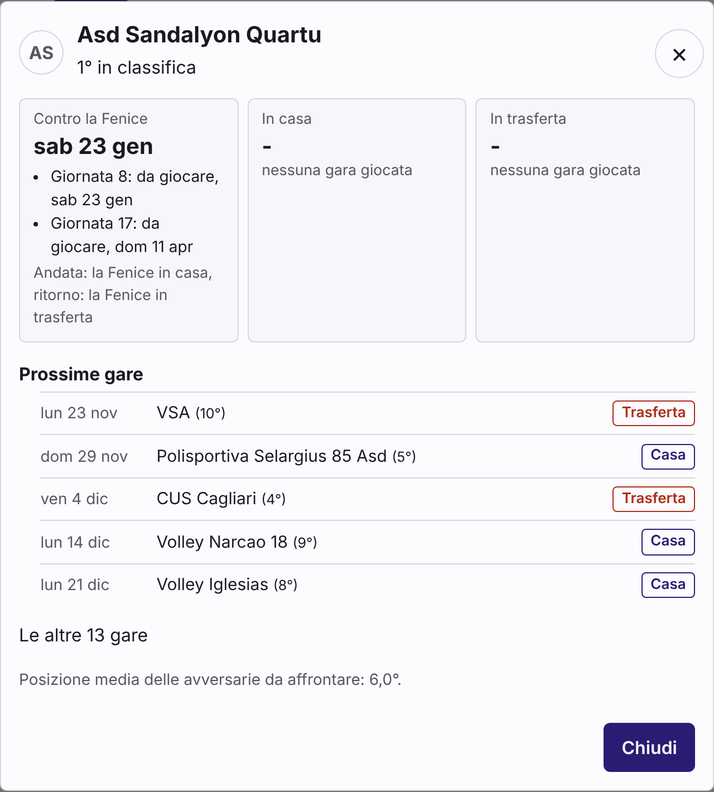
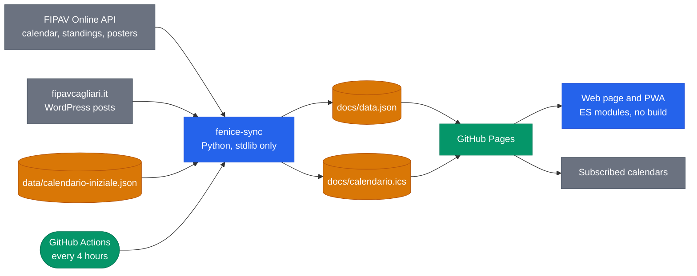

**English** | [Italiano](./README.it.md)

# Campionato Fenice 2026/27

Unofficial schedule, results and standings page for ASD Fenice in the FIPAV Cagliari Seconda Divisione Femminile, Girone A, 2026/27 season, kept in sync with FIPAV Online every 4 hours.

Site: https://andreabonn.github.io/campionato-fenice-fipav-26-27/

   

The page answers the questions a player, a parent or a supporter asks during the season: when and where the next game is, how the last one ended, where the team stands. Everything is in Italian, works on a phone and can be installed as an app.

A scheduled GitHub Action reads the FIPAV Online JSON API for group `64444`, merges it with the season's initial schedule and the Cagliari committee's notices, and writes a validated `data.json` and an iCalendar feed. The page is static: plain ES modules that render that file, with no build step and no runtime dependencies.

## In practice



<p>
  
  
</p>

Screenshots taken on 21 November 2026, before the first game of the season: every team is still at 0 points.

## What the page shows

- **Next game**: opponent, date, time, venue, countdown, map directions, the game poster and the live score link when FIPAV publishes them.
- **Last result** and a strip with the last five games.
- **Schedule and results**, round by round: set scores, the referee once assigned, and a "moved" label on games whose date, time or venue differ from the initial schedule.
- **Standings** as FIPAV publishes them, penalties included, with the Fenice highlighted. Once the table narrows, each team gets the final positions it can still reach and what is already decided.
- **Team card** for every opponent, opened from the standings or from the next game: head to head with the Fenice, games left, home and away record.
- **Analysis of the Fenice**: sets won and lost, tie-breaks, close sets, home and away, run-in.
- **Committee notices** about the Seconda Divisione, hidden while there are none.
- **Calendar**: a subscribable `.ics` feed that updates itself, or a single game added to Google Calendar.
- **Installable app** with an update notice when a new version is published.

The league formula has not been published yet, so the standings show no promotion or relegation zones and ties are broken by a provisional rule: wins, then set ratio, then point ratio.



## Data sources

Game data comes from [FIPAV Online](https://www.fipavonline.it) and notices from the [FIPAV Cagliari committee](https://fipavcagliari.it). Opponent crests are loaded from FIPAV Online; when one does not load, the page shows the team initials. The data belongs to FIPAV: this page reports it as published and is not an official site of the Federation or of the club.

If FIPAV Online does not answer, the run fails without writing anything: the page keeps the last valid data and the time of the last successful check does not change. A result entered by the federation can take up to 4 hours to appear.

## Tech stack

- **Sync**: Python 3.12+, standard library only (`urllib`, `json`, `zoneinfo`). Dev tools through [uv](https://docs.astral.sh/uv/): pytest, pytest-cov, ruff, mypy in strict mode.
- **Page**: HTML, CSS and plain ES modules, no framework, no bundler, no npm dependencies. Service worker and web manifest for offline use and installation.
- **Hosting and automation**: GitHub Pages, GitHub Actions.

## Architecture



`fenice-sync` tries `data.fipavonline.it` first and `app.fipavonline.it` as a fallback, one request per second. The Fenice is identified by its FIPAV club code, not by team name or id. All outputs are built in memory and validated against the schema before any file is written, then moved into place together.

## Prerequisites

- [uv](https://docs.astral.sh/uv/) (it installs Python 3.12 if missing)
- Node.js, for the JavaScript tests. No minimum version is pinned; the tests use the built-in `node --test` runner.

## Installation

1. Clone the repository and enter it.
2. Install the Python environment and check the import:

   ```bash
   npm run setup
   ```

No `.env` file and no API key are needed: both sources are public.

## Running locally

```bash
npm run sync      # fetch FIPAV and the committee, update docs/data.json, calendario.ics, status.json
npm run serve     # static server on docs/ at http://localhost:8000
```

`npm run sync` uses the network. The page alone can be served with the `docs/data.json` already in the repository.

## Repository structure

```text
.github/workflows/    sync.yml (sync and deploy), tests.yml (tests and badges)
assets/               club logo and README screenshots
data/                 calendario-iniziale.json, the baseline schedule
docs/                 the published site: index.html, JS modules, styles, data.json, calendario.ics, sw.js
scripts/              icon generator and standings benchmark
specs/                requirements, plan and task list
src/fenice_calendar/  the sync pipeline
tests/                pytest suites, tests/js for the page, tests/fixtures with frozen responses
```

## Main modules

| Module | Role |
|---|---|
| `fetch.py` | HTTP with fallback host, timeout, rate limit; non-JSON answers rejected |
| `parse.py`, `merge.py` | FIPAV calendar and standings into games; differences from the initial schedule |
| `notices.py`, `posters.py`, `enrich.py` | committee notices and game posters; an outage keeps the previous ones |
| `schema.py` | `data.json` schema (version 1), unexpected keys and inconsistent data rejected |
| `ics.py` | iCalendar feed, Europe/Rome, stable UID per game |
| `output.py` | atomic writes, files rewritten only when content changes |
| `cli.py` | `fenice-sync` entry point; on failure saves the received responses in `reports/sync-failure/` |

Command-line entry points, from `pyproject.toml`:

| Command | Purpose |
|---|---|
| `uv run fenice-sync` | run the sync |
| `uv run fenice-stamp-sw` | stamp the app version into `docs/sw.js` (CI only) |
| `uv run fenice-badges` | turn JUnit and coverage reports into shields.io JSON (CI only) |

## Testing

```bash
npm run test:py   # pytest with branch coverage
npm test          # page rules and views, node --test
npm run lint      # ruff and mypy --strict on src and tests
```

Tests never touch the network or the live `docs/data.json`: they run on FIPAV and WordPress responses frozen in `tests/fixtures/`. When FIPAV changes the shape of a response, the failing run uploads what it received as the `fipav-responses` artifact; that file becomes the new fixture.

## Deployment and CI/CD

- `.github/workflows/sync.yml` runs every 4 hours (minute 17), on push to `main` and on demand. It runs both test suites, the sync, commits `data.json` and `calendario.ics` when they changed, stamps the app version into the service worker and deploys `docs/` to GitHub Pages. The development report in `docs/` is removed before publishing.
- `.github/workflows/tests.yml` runs on push to `main`: tests with coverage, ruff and mypy. It publishes the test and coverage badges to the `badges` branch, also when the run is red.

Actions are pinned to commit SHAs.

## Security

To report a vulnerability, see [SECURITY.md](./SECURITY.md).

## License

Released under the MIT License. See [LICENSE](./LICENSE). The game data belongs to FIPAV.

## Support the project

If the page is useful to you, consider giving the [repository](https://github.com/AndreaBonn/campionato-fenice-fipav-26-27) a star on GitHub.

Campionato Fenice 2026/27 is free to use. If it helps you and you want to give something back, you can leave a tip via PayPal. The amount is up to you and it is entirely optional.

<p align="center">
  <a href="https://paypal.me/AndreaBonacci19"></a>
</p>

Maintained by [Andrea Bonacci](https://github.com/AndreaBonn).
